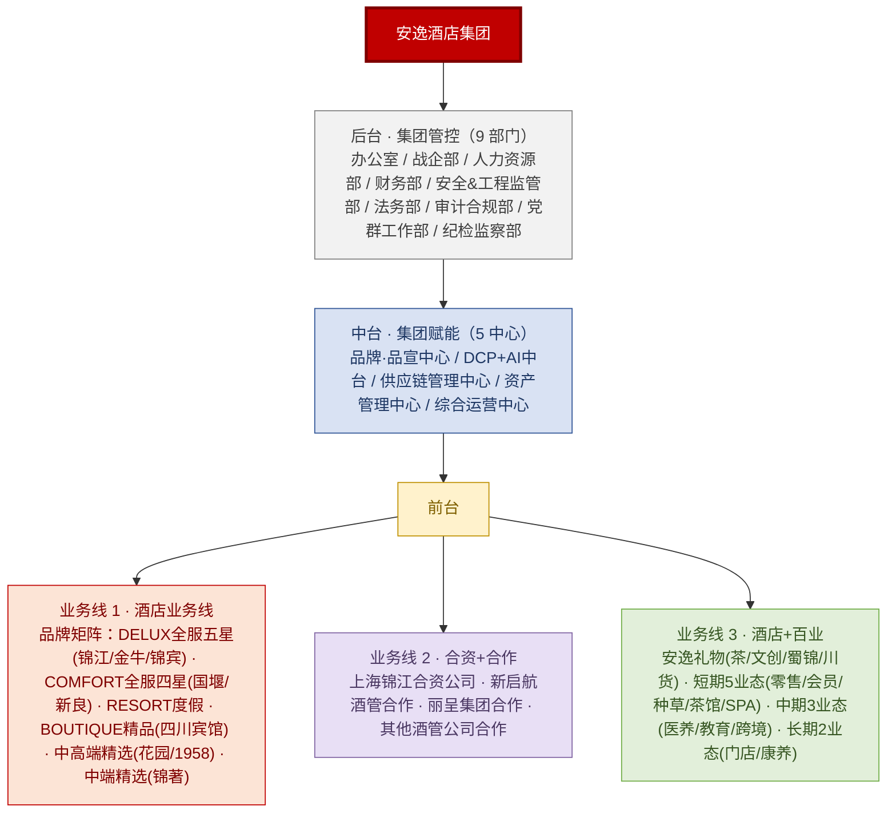

# 安逸集团业务条线拓扑图 v8.0

> 上下贯穿：集团 → 后台 → 中台 → 前台 → 业务板块（3 大业务线）。说明附后。
> 权威版式：PPTX（`C:\Users\ericz\Desktop\产业发展部\安逸集团业务条线拓扑图_v8.0_2026-10-04.pptx`）
> 编制：B166ER ｜ 2026-10-04

## 说明（附后，不入图）

1. 上下贯穿一条线：集团 → 后台 → 中台 → 前台 → 业务板块（3 大业务线）。
2. 中台「综合运营中心」= SOP · 会员 · 渠道 · MICE · 大客户 · 客服（MICE 属综合运营体系，不在酒店+百业）。
3. 3 大业务线为基本固定的骨架；每条业务线下的模块（品牌档、合作项目、业态）随时可开、可关，根据业务自身发展情况和市场态势动态调整。
4. 新模块落地采取「揭榜挂帅 + 赛马机制」：谁有方案、谁有团队、谁有资源，谁揭榜领办；多个候选同台赛马，跑出成效再固化。
5. 安逸集市 = 礼物商城（第二曲线私域承载工具）、安逸购 = 集团酒店供应链工具，均为工具，不占业务线模块位。
