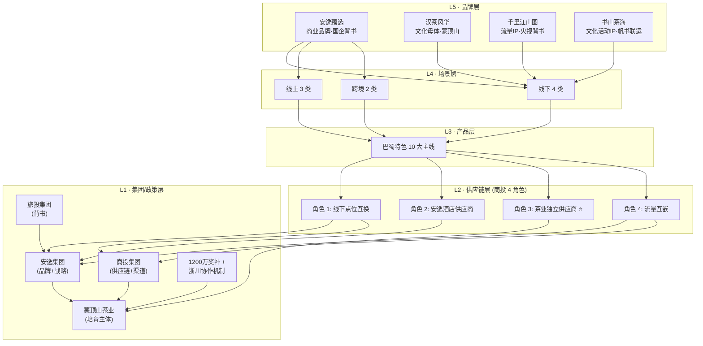

# 安逸臻选二销业务全景方案 v1.0

> **编制单位**：安逸酒店集团有限责任公司 产业发展部
> **送呈单位**：四川蒙顶山茶业有限公司
> **文档定位**：产业发展部给茶业公司的**参考方案**（非终稿，待茶业公司讨论完善）
> **编制日期**：2026 年 10 月 19 日
> **版本**：v1.0

---

## 一、文件信息

| 项目 | 内容 |
|------|------|
| 文件名 | 二销业务全景方案 v1.0 |
| 主送 | 四川蒙顶山茶业有限公司（培育主体/对外合作承载方） |
| 主送负责人 | 茶业公司领导 |
| 抄送 | 集团领导层、集团本部部门（资产运营中心/运营管理中心/财务部/审计合规部）、饭店管理公司 |
| 主撰 | 产业发展部（张实） |
| 联系电话 | ——（产业发展部） |
| 密级 | 内部 |

---

## 二、执行摘要（TL;DR）

以"安逸臻选"为商业品牌、以"汉茶风华"为文化母体、以"双集团资源"为运营底盘、以"巴蜀文化"为差异化锚——构建**茶产业 + 文旅 + 酒店 + 跨境**四轮驱动的二销新零售体系。

**三句话讲清**：
1. **谁来做**：茶业公司作为培育主体和对外合作承载方，承担自建平台和线下场景落地
2. **做什么**：5 块业务——品牌打造、供应链搭建、线上运营、线下拓展、私域沉淀
3. **怎么分利**：集团只收品牌+战略管理费（试点期免），不参与运营分钱；茶业公司为主体激励（50-60%）；酒店/景区点位按销售分润（15-30%，**参考全网亚朵/全季/桔子等成熟模式**）；商投有 4 重角色（点位互换/酒店供应商/茶业独立供应商/流量互嵌）

---

## 三、业务架构（5 层闭环）



**配套业务拓扑图**：见同目录 `业务拓扑图_v1.0.html`（交互式 SVG 拓扑图）和 `业务拓扑图_v1.0.png`（位图版）。

---

## 四、线下 4 类场景方案

### 场景 1：公共区货架 + 自动售货机

| 模式 | 茶业 | 酒店 | 集团 | 全网参考 |
|------|------|------|------|---------|
| **自营售货机** | 80% | 15%（纯点位费） | 5%（品牌挂名） | 友宝/魔购——酒店 25-30% |
| **传统货架分润** | 60% | 30% | 10% | 亚朵零售——扣点+底价 |

**巴蜀特色化**：自动售货机**嵌入"千里江山图"语音导览**——扫码商品即听蒙顶山典故（30-60 秒音频）。

**SKU 建议**：袋泡茶（甘露花雨延伸）、茶味川点（茶味冰粉、茶味花椒糖）、川剧变脸/熊猫/三星堆主题陈列品。

### 场景 2：客房入货（mini-bar + 伴手礼）

| SKU | 售价 | 茶业毛利 | 酒店分润 | 巴蜀特色 |
|-----|------|---------|---------|---------|
| mini-bar 茶饮 | ¥25-35 | 50% | 30% | 蒙顶甘露·袋泡系列 |
| mini-bar 茶点 | ¥18-28 | 45% | 30% | 竹叶青茶点+麻辣川茶糖 |
| 客房伴手礼 | ¥98-198 | 60% | 25% | 蒙山五峰小罐+蜀锦包装 |
| 升级伴手礼（VIP）| ¥298-598 | 65% | 20% | 吴理真茶+三星堆/熊猫茶宠 |

**全网基准**：亚朵 mini-bar 茶饮毛利率 50-70%、酒店分润 30%；全季 50-65%、25%；桔子水晶 30-40%（IP 联名款）。

### 场景 3：主题房 ⭐ 核心抓手

| 档次 | 房型名 | 售价（平日/周末）| 茶业分润 | 酒店分润 | 巴蜀特色元素 |
|------|--------|----------------|---------|---------|------------|
| 入门档 | "茶香"主题房 | ¥698/¥898 | 20% | 80% | 仿汉茶器+甘露袋泡+蒙顶山典故卡 |
| 进阶档 | "茶境"主题套房 | ¥1288/¥1588 | 25% | 75% | +陈宗懋工作站半日体验+仿汉点茶 |
| 旗舰档 | "茶道"汉风沉浸套房 | ¥2288/¥2788 | 30% | 70% | +一日研学证书+吴理真联名礼+汉服旅拍 |

**全网主题房分润参考**：

| 模式 | 全网案例 | 房间溢价 | IP 方分润 | 茶业（IP 方）分润 |
|------|---------|---------|----------|----------------|
| IP 联名主题房 | Hello Kitty×锦江 | +30-50% | 10-15% | —— |
| 品牌联名主题房 | 亚朵×八马茶业 | +30-50% | 20-30% | 25-30% |
| 文化主题房 | 桔子×王者荣耀 | +30-50% | 15-20% | —— |
| **产地体验主题房** | **木莲庄/松赞** | **+50-100%** | **20-30%** | **25-35%（推荐模式）** |

**外部合作模式**（不只安逸系酒店）：

| 合作对象 | 模式 | 茶业角色 |
|---------|------|---------|
| 青城山/峨眉山酒店 | 主题房授权 + 联营 | 茶业提供 IP+茶器+体验 |
| 巴蜀周边民宿 | "汉茶风华认证民宿" | 茶业输出品牌+培训+供应链 |
| 全国连锁酒店（亚朵/华住/锦江高端线）| 品牌联名 | 茶业 IP 方，分润 25-30% |
| 景区内酒店（蒙顶山/碧峰峡）| 深度合作 | 茶业提供全栈+分润 30% |

### 场景 4：自动售货机（并入场景 1）

**24h 流量收割**——自营模式（茶业买设备 1.5-3 万/台），给酒店**纯点位费** 2000-3000 元/月。

---

## 五、线上 3 类场景

### 场景 5：自建电商平台（茶业公司主导）

| 维度 | 建议 |
|------|------|
| **技术选型** | 有赞（餐饮零售 SaaS 头部，月费 ¥600-3000）或微盟 |
| **启动资金** | 50-80 万（首年 SaaS+IT+运营）|
| **SKU 策略** | 30-50 个起步 |
| **会员体系** | 自建会员（与安逸会员数据**未来桥接**，当下不合并）|
| **冷启动** | 安逸美舍/茶山游客→扫码进私域→沉淀到自建平台 |
| **分润** | 茶业 100%（自有平台），集团 0%（试点期免品牌抽成）|

### 场景 6：代运营 + 新媒体矩阵

| 平台 | 优先级 | 推荐服务商 | 巴蜀特色内容 |
|------|--------|----------|------------|
| 抖音 | **P0** | 云孚里（成都·西南唯一抖音酒旅共管账户）| 千里江山图航拍+院士工作站直播 |
| 小红书 | **P0** | 自在云（成都·本地生活服务商第 5 家）| 茶山汉服旅拍+汉式点茶 |
| 视频号 | P1 | 大羊传媒 | 中老年茶客群+文化深度内容 |
| 微信私域 | P1 | 有赞工具 | 茶山会员社群+茶文化讲堂 |

### 场景 7：跨境电商

| 平台 | 优先级 | 选品 | 巴蜀特色化 |
|------|--------|------|----------|
| 亚马逊 US/JP | **P0** | 蒙山五峰/吴理真茶 | 包装"中国茶圣·吴理真"故事 |
| TikTok Shop | **P0** | 联名款（书山茶海）+ 茶器 | 千里江山图视觉+汉式点茶视频 |
| 阿里国际站 | **P1** | 三文鱼+菜油（商投供货 B2B）| 国资委背书+批量供应 |
| 丝路易购 | **P0** | "安逸"品牌已运营（需核实商标）| 川茶文化输出 |

---

## 六、商投 4 角色（修正版）

```
商投集团 × 安逸集团合作（4 角色全景）
    │
    ├── 角色 1：线下点位互换方
    │   （不涉钱，资源互换）
    │   安逸酒店公共空间 ↔ 商投红旗连锁/曙光汇
    │
    ├── 角色 2：安逸酒店供应商
    │   （涉钱，集团级采购）
    │   糖酒+三文鱼+菜油+焕新生活食材
    │   → 走安逸购（B 端集采平台）
    │
    ├── 角色 3：茶业公司独立供应商 ⭐ 新增
    │   （涉钱，独立采购关系）
    │   茶业自建平台 + 跨境电商选品
    │   → 走茶业公司采购流程
    │
    └── 角色 4：流量互嵌方
        （涉钱，渠道关系）
        安逸会员 160 万 ↔ 曙光汇 700 万
        （后期桥接，业务不合并）
```

**为什么角色 3 重要**：自建平台和跨境 SKU 不能仅靠茶叶——需要丰富品类（茶+酒+食材+川货）；茶业公司直接向商投采购比走安逸购更快、更灵活、选品权自主。

---

## 七、巴蜀特色 10 大产品主线

| # | 品类 | 巴蜀文化锚 | 推荐 SKU | 渠道 |
|---|------|------------|---------|------|
| 1 | 蒙顶甘露 | 世界茶文化发源地 | 蒙山五峰/甘露元年 | 全渠道 |
| 2 | 蒙顶黄芽 | 三黄特色 | 黄芽系列 | 高端渠道 |
| 3 | 雅红工夫 | 蜀地红茶 | 雅红系列 | 中端渠道 |
| 4 | 古蜀藏茶 | 黑茶鼻祖/茶马古道起点 | 藏茶系列 | 特色渠道 |
| 5 | 茶器（竹编/蜀锦）| 非遗 | 雅安竹编茶器+蜀锦茶席 | 主题房+伴手礼 |
| 6 | 茶食（茶宴/川点）| 川菜大师+茶 | 茶味冰粉/茶味花椒糖/麻酱茶酥 | mini-bar+主题房 |
| 7 | 茶宠（熊猫/三星堆）| 国宝 IP | 熊猫茶宠/三星堆青铜器茶宠 | 主题房+伴手礼 |
| 8 | 非遗联名（川剧/变脸）| 巴蜀非遗 | 川剧变脸茶礼盒 | 伴手礼+跨境 |
| 9 | 书山茶海文创 | 帆书×蒙顶山 | 联名茶礼+联名茶器 | 线下+线上 |
| 10 | 千里江山图衍生 | 央视 IP | 千里江山图主题茶礼 | 全渠道 |

---

## 八、参考全网酒店分润基准

| 模式 | 全网案例 | 茶业/IP 方 | 酒店/点位 | 备注 |
|------|---------|----------|----------|------|
| mini-bar 茶饮 | 亚朵 | 50-70% 毛利 | 30% 分润 | 高溢价 |
| mini-bar 茶饮 | 全季 | 50-65% 毛利 | 25% 分润 | 标准化 |
| IP 联名主题房 | Hello Kitty×锦江 | 10-15% | 85-90% | IP 授权 |
| 品牌联名主题房 | 亚朵×八马茶业 | 25-30% | 70-80% | 联营 |
| **产地体验主题房** | **木莲庄/松赞** | **25-35%（推荐）** | **65-75%** | **溢价高** |
| 酒店自动售货机 | 友宝/魔购 | 65-75%（自营）| 25-30% | 24h |
| 酒店伴手礼 | 行业基准 | 60-75% | 25-40% | 高毛利 |

**关键判断**：
- **酒店分成只涉及在酒店展销的线下部分**（茶业 ↔ 酒店/景区）
- **商投集团点位互换不涉及利润分成**（是资源互换行为）
- **真正需要分配的是线上部分**（自建平台 GMV 分账）
- 集团**试点期免品牌授权费**（培育期），复制期按 GMV 5-8% 抽成

---

## 九、主题房与外部合作模式

### 主题房 3 档设计（基于全网+巴蜀化）

- **入门档**（"茶香"）：¥698-898，加价 30-50%，茶业分润 20%，酒店 80%
- **进阶档**（"茶境"）：¥1288-1588，加价 50-80%，茶业 25%，酒店 75%
- **旗舰档**（"茶道"）：¥2288-2788，加价 80-120%，茶业 30%，酒店 70%

### 外部合作四象限

| ↓ 对象 \ → 模式 | 主题房授权 | 品牌联名 | 深度合作 |
|----------------|----------|---------|---------|
| **青城山/峨眉山酒店** | ✅ | ✅ | ⭐ |
| **巴蜀周边民宿集群** | ✅ | ⭐ | ✅ |
| **全国连锁（亚朵/华住/锦江高端线）**| —— | ⭐ | ✅ |
| **景区内酒店（蒙顶山/碧峰峡）**| ✅ | ✅ | ⭐ |

---

## 十、跨境业务（"川茶出海"）

### 全网参考

| 茶企 | 跨境模式 |
|------|---------|
| 八马茶业 | 自建独立站 + 亚马逊 |
| 小罐茶 | 跨境试点 |
| 亚朵海外 | 借船出海（与海外平台合作）|

### 安逸臻选跨境路径

| 阶段 | 路径 | 重点 |
|------|------|------|
| **试点期** | 丝路易购（借船）+ 亚马逊 US | 5-8 个 SKU，高客单非标 |
| **复制期** | 丝路易购+亚马逊+TikTok Shop+阿里国际站 | 30+ SKU，多平台矩阵 |
| **远期** | 自建独立站+海外仓 | 海外品牌建设 |

### 跨境选品建议（高客单非标）

| SKU | 平台 | 客单价 | 巴蜀特色化 |
|-----|------|--------|----------|
| 甘露元年·朝露 120g | 亚马逊 US | ¥1268 | 川茶国际锚点 |
| 蒙山五峰甘露特级 | 亚马逊 JP | ¥2980-5000 | 日本茶文化基因相近 |
| 蜀锦非遗联名茶礼 | Etsy / 独立站 | ¥800-1500 | 非遗+独家 |
| 吴理真藏茶 | 阿里国际站（B2B）| 议价 | 华人圈文化 IP |

---

## 十一、90 天路线图

| 阶段 | 时间 | 关键动作 | 输出 |
|------|------|---------|------|
| **T+0~15** | 10-19 ~ 11-02 | 商标核查+运营方接触+主题房选址 | 商务接触清单+主题房方案 v1.0 |
| **T+15~30** | 11-03 ~ 11-17 | 跨境方签约+主题房样板落地+商投独立供货协议 | 跨境意向+1 家旗舰酒店主题房+商投与茶业独立供货合同 |
| **T+30~60** | 11-18 ~ 12-17 | 自建平台 MVP+自动售货机首批+mini-bar 升级 | 自建平台上线+30 家酒店自动售货机+50 家酒店 mini-bar 商投 SKU |
| **T+60~90** | 12-18 ~ 01-16 | 跨境首单+主题房复制+书山茶海发布会 | 跨境首单+5-10 家酒店主题房+书山茶海发布会执行 |
| **T+90 后** | 01-17 ~ | 复制期 | 30+ 酒店+10+ 主题房+跨境常态化 |

---

## 十二、风险与护栏

| 风险 | 触发条件 | 护栏 |
|------|---------|------|
| **商投商标冲突** | 丝路易购已用"安逸" | 法务 1 周内出核查报告 |
| **跨境合规** | 茶/食品/文创出口违规 | 优先用丝路易购（省港投旗下·有现成合规）|
| **酒店分润倒挂** | 内部参考不充分 | 严格按全网基准+阶段化设计 |
| **文化 IP 价值稀释** | "汉茶风华"与"千里江山图"混用 | 双母体独立运营，不混用 |
| **国资委审计** | 资源互换≠采购 | 所有协议分类清晰 |
| **外部酒店合作合规** | 国资委对外合作"三重一大" | 选头部连锁+走合规流程 |
| **会员数据合规** | 200 万会员数据桥接 | 仅做"成交订单"对接，不做"会员档案"对接 |
| **1200 万奖补挪用** | 地方政府截留 | 集团高层带队拜会名山区，事前沟通+事中监控 |

---

## 十三、立即可执行清单

### 今天（10-19）

- [ ] 集团法务启动商标核查（"安逸"在丝路易购的注册情况）
- [ ] 茶业公司出《主题房方案 v1.0》+《巴蜀特色 10 大主线选品 v1.0》
- [ ] 联系云孚里+丝路易购，启动商务接触
- [ ] 与商投启动**《独立供货框架协议》**谈判（角色 3）

### 本周（10-19 ~ 10-25）

- [ ] 集团办公会汇报《分配机制方案 v2.0》（修正版）
- [ ] 启动 1 家旗舰酒店主题房选址（建议：安逸美舍等安逸集团直营或纳管酒店；锦江宾馆、金牛宾馆已提级由旅投集团直接管理、与安逸集团平级，第一阶段暂不纳入二销合作范围）
- [ ] 集团办文下放《安逸臻选专班方案》（走文件下三级公司执行）

### 30 天（10-19 ~ 11-18）

- [ ] 完成 1 家旗舰酒店 3 间汉茶风华主题房样板
- [ ] 完成 10 家酒店自动售货机部署
- [ ] 完成 30 家酒店 mini-bar 升级（商投天府优选 SKU）
- [ ] 跨境 SKU 5-8 个上架

### 90 天（10-19 ~ 2027-01-17）

- [ ] 完成 1 原型店 + 3 酒店 + 30 SKU 试点
- [ ] 完成跨境首单 + 抖音/小红书账号搭建
- [ ] 集团办公会通过分配机制正式文件
- [ ] 完成与商投 9 项待确认事项拍板

---

## 十四、附件清单

| 附件 | 文件 | 用途 |
|------|------|------|
| 附件 1 | 业务拓扑图（HTML 版）| 交互式查看 |
| 附件 2 | 业务拓扑图（PNG 版）| 印刷/邮件 |
| 附件 3 | 安逸-商投合作框架协议 v1.3 | 合作基础 |
| 附件 4 | 安逸臻选新零售业态培育工作专班方案（修订版）| 治理结构 |
| 附件 5 | 安逸臻选（拟）双集团合作框架要点（讨论稿）| 9 项待确认 |
| 附件 6 | 安逸臻选外部合作运营商全景报告 v3.0 全国版 | 70+ 候选方 |
| 附件 7 | 蒙顶山茶业 2025 企业介绍 | 茶业公司基本面 |
| 附件 8 | 蒙顶山茶业产品报价表（20260828）| SKU 报价 |
| 附件 9 | 安逸茶山&安逸美舍产品列表（2026.8.26）| 现有产品 |
| 附件 10 | 安逸美舍·蒙顶山茶旅融合项目合作推介 | 美舍资源 |
| 附件 11 | 250306 安逸茶山康养休生谷项目汇报 PPT | 康养配套 |
| 附件 12 | 书山茶海·千里入画活动方案 | 帆书联运 |
| 附件 13 | 安逸茶山文旅融合新场景项目推进会纪要（10-08）| 1200 万奖补 |
| 附件 14 | 四川省旅投与商投集团业务合作对接会（9-18）| 双集团合作起源 |
| 附件 15 | 安逸集团二销业务体系搭建方案探讨（10-18）| Eric 思路原始记录 |

---

> **编制说明**：
> 1. 本方案为产业发展部给茶业公司的**参考方案**，非终稿
> 2. 茶业公司收到后请组织专题讨论，提出修改意见
> 3. 修订后由产业发展部统一报集团办公会审批
> 4. 最终方案以集团文件下发为准
>
> **联系窗口**：产业发展部（张实）

— 安逸酒店集团有限责任公司 产业发展部
— 2026 年 10 月 19 日
