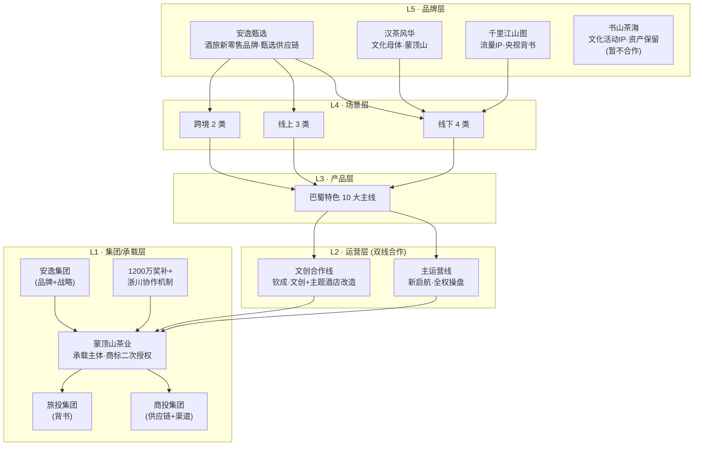

# 安逸臻选二销业务全景方案 v1.1

> **编制单位**：安逸酒店集团有限责任公司 产业发展部
> **送呈单位**：四川蒙顶山茶业有限公司
> **文档定位**：产业发展部给茶业公司的**参考方案 v1.1**（基于 10-19 重大更新）
> **编制日期**：2026 年 10 月 19 日
> **版本**：v1.1（**新增新启航作为全权操盘方 / 引入钦成文旅作为文创合作线 / 暂不考虑帆书 / 品牌名统一为"安逸甄选"**）
> **前版**：v1.0（10-19 上午，已归档）

---

## 一、v1.1 重大更新说明（相对 v1.0）

| 维度 | v1.0（已废）| **v1.1（当前）** |
|------|------------|----------------|
| 品牌名 | 安逸臻选 | **安逸甄选**（按党委会议案和 9.16 协议统一）|
| 运营方 | 多个候选商之一 | **新启航 = 全权操盘方**（战略级）|
| 蒙顶山茶业 | 待定 | **已确认为承载主体**（集团商标全部授权茶业）|
| 帆书 | 重点合作方 | **暂不考虑**（"书山茶海"作为文化 IP 保留）|
| 钦成文旅 | 未提及 | **新加入：文创+主题酒店改造合作线**（独立线）|
| 跨境 | 远期愿景 | **已有落地需求**（电子文创出海 40 元 → 50 美金）|

---

## 二、文件信息

| 项目 | 内容 |
|------|------|
| 文件名 | 二销业务全景方案 v1.1 |
| 主送 | 四川蒙顶山茶业有限公司（培育主体/对外合作承载方）|
| 主送负责人 | 茶业公司领导 |
| 抄送 | 集团领导层、集团本部部门（资产运营中心/运营管理中心/财务部/审计合规部）、饭店管理公司 |
| 主撰 | 产业发展部（张实、蒋抒伶）|
| 密级 | 内部 |

---

## 三、执行摘要（TL;DR）

**两层授权、双线合作、独立平台**：

```
安逸集团（品牌+战略）
   ↓ 商标全部授权
蒙顶山茶业（承载主体·二销业务落地）
   ↓ 品牌二次授权
   ├─→ 新启航（全权操盘方·主运营线）   ← 电商+新媒体平台路径
   │      └─ 安逸甄选（甄不是臻）品牌全链条运营
   └─→ 钦成文旅（文创+主题酒店改造线）   ← 独立合作线
          └─ 文创二销产品+主题酒店改造
```

**三句话讲清**：
1. **谁来承载**：蒙顶山茶业（不是新启航）作为二销业务承载主体，集团全部商标已授权茶业
2. **谁来操盘**：新启航作为**全权操盘方**，独立打造"安逸甄选"品牌+电商+新媒体平台（已签框架协议）
3. **双线合作**：新启航 = 主运营线（品牌+电商）；钦成 = 文创合作线（文创产品+主题酒店改造）

---

## 四、关键认知修正（基于 5 份新文件）

| 之前认知 | 实际事实 | 来源 |
|---------|---------|------|
| 蒙顶山茶业=待定承载方 | **茶业 = 已确认承载主体**（集团商标全部授权至茶业）| 0821 钦成会议（产业发展部与茶业公司参会）|
| 新启航=候选运营方之一 | **新启航 = 全权操盘方**（乙方全权操盘"安逸甄选"品牌运营）| 8.31 党委会议案+9.16 协议 3.2.2 |
| 品牌名"安逸臻选"（臻）| **"安逸甄选"（甄）**——5 个文件全部用"甄" | 8.31 议案/9.10 律师审核/9.16 协议/v2.0/0821 钦成 |
| 帆书=重点合作方 | **暂不考虑帆书**（用户 10-19 指令）| 用户最新指令 |
| 跨境=远期愿景 | **已有落地需求**：东方文化电子文创 40 元国内 → 50 美金海外 | 0821 钦成会议 |
| 钦成=备选合作方 | **钦成=文创合作线**（城市更新+非遗+九寨有礼+电商直播）| 0821 钦成会议 |
| "安逸集市"是新启航做 | **"安逸集市"是安逸集团已建成的数字化中台之一**（会员订房+商城+安逸集市）| 0821 钦成会议 |

---

## 五、业务架构（5 层闭环·v1.1 重构版）



**配套业务拓扑图**：见同目录 `业务拓扑图_v1.1.html`（交互式 SVG 拓扑图）和 `业务拓扑图_v1.1.png`（位图版）。

---

## 六、运营方角色重定义

### 主运营线：新启航（**全权操盘方**）⭐

**角色定位**（基于 9.16 协议 3.2.2）：
> "甲方可授权乙方**全权操盘**'安逸甄选'品牌运营，乙方负责品牌全链条工作：包括但不限于：商品选品与供应链搭建；线下门店布局；**线上全域运营**；战略投资人引进；品牌推广与市场拓展等。"

**新启航的核心能力**（基于 8.31 协议 1.2）：
- 四川省内已成功运营多家酒店
- 成熟的标准化运营管理团队
- 完整的 SOP 作业体系（前台/客房清洁/定价/成本管控/OTA 全链条）
- 广泛的商务资源
- **酒旅新零售实操能力**
- 可独立完成项目落地、市场拓展、战略投资人引进

**用户 10-19 补充**：
> "新启航是准备做一个**电商和新媒体平台的路径**"
> → 这与协议中"线上全域运营"一致
> → 新启航将构建**独立电商平台 + 新媒体矩阵**

**新启航的 5 年期目标**（基于 8.31/9.16 协议）：
- 6 个月内：至少提供 5 家符合安逸品牌标准的酒店项目挂牌（v2.0 简化为"年度合作计划"）
- 持续：酒旅新零售业务独立打造

**资源支持**（集团开放给新启航）：
- 全部连锁酒店门店作为线下展示与销售场景
- 全域会员体系（APP/小程序/企微社群）作为流量入口
- 集团集采渠道与供应商资源作为供应链基础
- 品牌背书与媒体资源

### 文创合作线：钦成文旅（**独立合作线**）

**钦成核心能力**（0821 会议）：
- 新兴控股旗下文旅主体
- 深耕文旅 10 年
- 标杆项目：成都玉林东街城市更新、阿坝非遗主题公园、兴隆湖片区
- 非标酒店：「西岭·围坐」（酒店+街巷融合）
- 文创 IP：「九寨有礼」（登陆过卢浮宫非遗展）
- 自研灵山大模型（工信部备案）+ 电商直播团队
- "内容-场景-资本"全价值链生态构建

**钦成在双线中的角色**：
- 主题酒店改造（四川宾馆、都江堰国堰宾馆、古尔沟、雅安安逸茶山、乐山嘉州、新良大酒店——6 个核心点位）
- 文创二销产品研发（非遗+电子文创+特色农产品）
- **跨境业务**（电子文创出海 40 元 → 50 美金）
- 与新启航的差异：钦成主打**文创+改造**；新启航主打**品牌+电商+新媒体**

### 蒙顶山茶业（**承载主体·已确认**）

**集团授权逻辑**（0821 钦成会议明确）：
> "二销业务后续将整体纳入四川蒙顶山茶业有限公司承载运营；**集团将全部商标品牌授权至蒙顶山茶业**，由其开展二次授权与具体业务落地。"

**茶业公司角色**：
- 集团商标持有人（被授权方）
- 二次授权方（向新启航/钦成授权）
- 5 大业务环节的实际承载方
- 自有品牌资源（蒙山五峰/甘露元年/吴理真/古蜀藏茶等）

**茶业的具体责任**：
- 与新启航签《安逸甄选新零售合作专项协议》
- 与钦成签《文创二销合作协议》
- 品牌质量监督（蒙山五峰等自有品牌）
- 巴蜀特色 10 大主线的选品
- 蒙顶山实地资源（牛碾坪+陈宗懋工作站+汉茶风华）

---

## 七、线下 4 类场景方案（v1.1 保持不变）

| 场景 | 主运营方 | 资源支持 | 分润（建议）|
|------|---------|---------|------------|
| 公共区货架+自动售货机 | **新启航** | 酒店门店（茶业对接）| 新启航 60% / 酒店 30% / 集团 10% |
| 客房入货（mini-bar+伴手礼）| **新启航** | 酒店客房（茶业对接）| 新启航 50% / 酒店 30% / 茶业品牌 20% |
| 主题房 3 档 | **新启航**（IP+联名产品）+ **钦成**（主题酒店改造合作点位）| 茶业 3 档主题房方案 + 钦成 6 个改造点位 | 茶业 25% / 酒店 70% / 新启航 5% |
| 自动售货机 | **新启航** | 茶业 1.5-3 万/台 + 酒店电源网络 | 茶业 60% / 酒店 30% / 集团 10% |

**全网分润基准**（参考）：
- 亚朵 mini-bar 茶饮：50-70% 毛利，30% 给酒店
- 全季 mini-bar 茶饮：50-65% 毛利，25% 给酒店
- 桔子 IP 联名主题房：30-40% 给酒店
- 产地体验主题房（木莲庄/松赞）：25-35% IP 方

---

## 八、线上 3 类场景（v1.1 重新定位）

### 场景 5：自建电商平台（**新启航主导**）

| 维度 | 建议（v1.1）|
|------|------------|
| **平台主体** | **新启航**（按用户指令：新启航做电商平台）|
| **品牌** | 安逸甄选 |
| **技术选型** | 有赞（餐饮零售 SaaS 头部，月费 ¥600-3000）或微盟 |
| **启动资金** | 80-120 万（首年 SaaS+IT+运营，新启航承担）|
| **SKU 策略** | 30-50 个起步（蒙顶甘露+汉茶风华+茶器+川点+电子文创）|
| **会员体系** | 新启航自建会员（与安逸会员数据**未来桥接**，当下不合并）|
| **冷启动** | 茶业游客→扫码进私域→沉淀到新启航平台 |
| **分润** | 新启航 100%（自有平台），集团 0%（试点期免品牌抽成）|

**关键判断**：
- 平台是**新启航的资产**，不是安逸集团的
- 但品牌"安逸甄选"是安逸集团→茶业→新启航的二级授权
- 新启航独立运营，自担风险，自负盈亏

### 场景 6：代运营 + 新媒体矩阵（**新启航主导**）

| 平台 | 优先级 | 推荐服务商 | 内容方向 |
|------|--------|----------|--------|
| 抖音 | **P0** | 云孚里（成都·西南唯一抖音酒旅共管账户）| 千里江山图航拍+院士工作站直播+采茶制茶直播 |
| 小红书 | **P0** | 自在云（成都·本地生活服务商第 5 家）| 茶山汉服旅拍+汉式点茶 |
| 视频号 | P1 | 大羊传媒 | 中老年茶客群+文化深度内容 |
| 微信私域 | P1 | 有赞工具 | 茶山会员社群+茶文化讲堂 |
| **B 站** | P2 | 自营+UP 主合作 | 茶文化深度内容/汉茶风华纪录片 |
| **视频号直播** | P0 | 自营+云孚里 | 书山茶海/千里江山图主题直播 |

### 场景 7：跨境电商（**新启航+钦成 双线**）

| 平台 | 优先级 | 运营方 | 选品 |
|------|--------|--------|------|
| 亚马逊 US/JP | **P0** | 新启航 | 蒙山五峰/吴理真茶 |
| TikTok Shop | **P0** | 新启航 | 茶器+汉风点茶视频 |
| 阿里国际站 | **P1** | 新启航 | 三文鱼+菜油（商投供货 B2B）|
| **Etsy** | **P0** | **钦成** | **东方文化电子文创**（40 元→50 美金）|
| 丝路易购 | P1 | 新启航 | "安逸甄选"品牌出海（需核实商标）|

---

## 九、商投 4 角色（v1.1 保持不变）

```
商投集团 × 安逸集团合作（4 角色全景）
    │
    ├── 角色 1：线下点位互换方
    ├── 角色 2：安逸酒店供应商（走安逸购）
    ├── 角色 3：茶业/新启航独立供应商 ⭐（自建平台选品）
    └── 角色 4：流量互嵌方
```

**关键变化**：角色 3 的采购方现在是**茶业 + 新启航双线**（不只是茶业）。

---

## 十、巴蜀特色 10 大产品主线（v1.1 保持不变）

| # | 品类 | 巴蜀文化锚 | 推荐 SKU | 渠道 |
|---|------|------------|---------|------|
| 1 | 蒙顶甘露 | 世界茶文化发源地 | 蒙山五峰/甘露元年 | 全渠道 |
| 2 | 蒙顶黄芽 | 三黄特色 | 黄芽系列 | 高端渠道 |
| 3 | 雅红工夫 | 蜀地红茶 | 雅红系列 | 中端渠道 |
| 4 | 古蜀藏茶 | 黑茶鼻祖/茶马古道起点 | 藏茶系列 | 特色渠道 |
| 5 | 茶器（竹编/蜀锦）| 非遗 | 雅安竹编茶器+蜀锦茶席 | 主题房+伴手礼 |
| 6 | 茶食（茶宴/川点）| 川菜大师+茶 | 茶味冰粉/茶味花椒糖/麻酱茶酥 | mini-bar+主题房 |
| 7 | 茶宠（熊猫/三星堆）| 国宝 IP | 熊猫茶宠/三星堆青铜器茶宠 | 主题房+伴手礼 |
| 8 | 非遗联名（川剧/变脸）| 巴蜀非遗 | 川剧变脸茶礼盒 | 伴手礼+跨境 |
| 9 | 书山茶海文创 | 帆书联运（**暂不合作**）| 联名茶礼 | **待定** |
| 10 | 千里江山图衍生 | 央视 IP | 千里江山图主题茶礼 | 全渠道 |

**第 9 项更新**：书山茶海文创暂不合作，但作为**文化资产**保留（未来可重启）。

---

## 十一、钦成文旅合作清单（基于 0821 会议）

### 主题酒店改造（6 个核心点位）

| 优先级 | 点位 | 改造重点 | 总投估算 | 投资回收 |
|--------|------|----------|---------|---------|
| **P0** | 四川宾馆 | 109 客房+日咖夜酒+零售展陈+设计工坊+150㎡多功能厅+早餐厅外迁 | 3500-4000 万 | 目标年流水 3000 万 / RevPAR 500 |
| **P0** | 都江堰国堰宾馆 | 都江堰水文化+"老钱风"空间+保留 4 星全服资质+旅投党校培训中心 | （待补）| —— |
| P1 | 古尔沟 | 软性文化植入+市场宣发（不硬件改造）| 轻投 | —— |
| P1 | 雅安安逸茶山 | 茶文化主题+汉茶风华 | （已有 1200 万奖补）| —— |
| P1 | 乐山嘉州宾馆 | （待细化）| —— | —— |
| P1 | 新良大酒店 | （待细化）| —— | —— |

### 文创二销产品

- **非遗主题**：川剧变脸/蜀锦/竹编/糖画
- **电子文创**：东方文化 IP 衍生（跨境重点品类，40 元 → 50 美金）
- **特色农产品**：川味茶点/茶味零食/雅安藏茶食品

---

## 十二、90 天路线图（v1.1 更新）

| 阶段 | 时间 | 关键动作 | 输出 | 主导方 |
|------|------|---------|------|--------|
| **T+0~15** | 10-19 ~ 11-02 | 商标核查+新启航协议细化+钦成协议启动 | 安逸甄选品牌统一+主协议 v3.0 | 产业部+茶业+新启航+钦成 |
| **T+15~30** | 11-03 ~ 11-17 | 茶业与新启航签《安逸甄选新零售合作专项协议》+钦成签《文创二销合作协议》+主题房样板选址 | 2 份专项合同+1 家旗舰酒店主题房 | 产业部+茶业+新启航+钦成 |
| **T+30~60** | 11-18 ~ 12-17 | 新启航自建平台 MVP 上线+钦成 6 个点位启动考察+自动售货机首批 | 新启航平台 MVP+30 家酒店自动售货机+6 个点位考察报告 | 新启航+钦成+茶业 |
| **T+60~90** | 12-18 ~ 01-16 | 跨境首单（亚马逊/Etsy）+主题房复制+1 个标杆改造（四川宾馆）+品牌发布会 | 跨境首单+5-10 家酒店主题房+1 个标杆改造+品牌发布会 | 新启航+钦成+茶业+集团 |
| **T+90 后** | 01-17 ~ | 复制期 | 30+ 酒店+10+ 主题房+6 个改造+跨境常态化 | 全面 |

---

## 十三、风险与护栏（v1.1 增补）

| 风险 | 触发条件 | 护栏 |
|------|---------|------|
| **新启航全权操盘失控** | 乙方独立运营，品牌方监督缺位 | 协议 3.2.2 留"重大事项须事先取得甲方书面同意" |
| **品牌名"甄选/臻选"不一致** | 党委会议案/协议/蒋方文档用字不同 | **v1.1 统一为"安逸甄选"**（甄）|
| **新启航数据归属** | 乙方独立运营产生数据 | 协议 4.1/4.2：会员数据归甲方；经营数据需对接甲方系统 |
| **新启航退出** | 协议解除/到期 | 协议 7.5：乙方已签项目通过三方协议转让给甲方/锦江饭店管理公司 |
| **品牌履约保证金** | 乙方连续 3 次被书面整改 | 协议 3.1.9：单个项目 5 万元扣保证金 |
| **跨境合规** | 茶/食品/电子文创出口 | 钦成：电子文创走 Etsy 渠道；新启航：丝路易购合作 |
| **国资委审计** | 资源互换≠采购 | 新启航走"品牌二次授权"模式（合规通道）|
| **钦成/新启航关系** | 两条独立线可能冲突 | 钦成=主题酒店改造+文创；新启航=品牌+电商+新媒体；差异化分工 |
| **帆书合作暂停的影响** | 书山茶海文创+联名款活动 | 保留文化资产 IP；不主动推进商业合作 |

---

## 十四、立即可执行清单（v1.1 更新）

### 今天（10-19）

- [ ] **品牌名统一**：行文/合同/品牌注册一律用"**安逸甄选**"（甄）
- [ ] **新启航**：产业部牵头，与茶业、新启航对齐专项协议关键条款
- [ ] **钦成文旅**：产业部牵头，与茶业、钦成对齐文创二销合作框架
- [ ] **新启航 6 个月硬指标**：v2.0 简化为"年度合作计划"，可立即对齐
- [ ] **跨境启动**：与钦成对齐电子文创 Etsy 渠道；与新启航对齐亚马逊渠道

### 本周（10-19 ~ 10-25）

- [ ] 茶业出《与新启航合作专项协议》初稿（沿用 9.16 协议 3.2.2 框架）
- [ ] 茶业出《与钦成文创二销合作协议》初稿
- [ ] 集团办公会汇报《二销业务全景方案 v1.1》（v1.0 升级版）
- [ ] 启动 1 家旗舰酒店主题房选址（建议：安逸美舍等安逸集团直营或纳管酒店；锦江宾馆、金牛宾馆已提级由旅投集团直接管理、与安逸集团平级，第一阶段暂不纳入二销合作范围）
- [ ] 集团办文下放《安逸臻选专班方案》（v1.1 修订）

### 30 天（10-19 ~ 11-18）

- [ ] 完成 1 家旗舰酒店 3 间汉茶风华主题房样板（茶业+新启航联合）
- [ ] 完成 10 家酒店自动售货机部署（新启航负责）
- [ ] 完成 30 家酒店 mini-bar 升级（商投天府优选 SKU）
- [ ] 钦成完成 6 个点位的实地考察报告
- [ ] 跨境 SKU 5-8 个上架（亚马逊+Etsy）

### 90 天（10-19 ~ 2027-01-17）

- [ ] 完成 1 原型店 + 3 酒店 + 30 SKU 试点
- [ ] 完成跨境首单（亚马逊+Etsy 各 1 单）
- [ ] 完成 1 个主题酒店标杆改造（四川宾馆或都江堰国堰宾馆）
- [ ] 完成 1 场品牌发布会（"安逸甄选"品牌升级）
- [ ] 集团办公会通过《分配机制正式文件》（含新启航+钦成）

---

## 十五、附件清单（v1.1 增补）

| 附件 | 文件 | 用途 |
|------|------|------|
| 附件 1 | 业务拓扑图（HTML v1.1）| 交互式查看 |
| 附件 2 | 业务拓扑图（PNG v1.1）| 印刷/邮件 |
| 附件 3 | 新启航框架协议 v2.0_再框架版（9 月版）| 主运营方基础 |
| 附件 4 | 新启航框架协议 9.16 原版 | 8.31 议案配套 |
| 附件 5 | 新启航框架协议 8.31 议案版（含 5 年+6 月 5 家硬指标）| 党委会审议稿 |
| 附件 6 | 新启航框架协议 9.10 律师审核稿（合作期 1 年）| 律师审核参考 |
| 附件 7 | 新启航框架协议 8.18 审核稿（早期版）| 历史版本 |
| 附件 8 | 关于召开安逸酒店集团与四川新启航酒旅合作框架协议研讨会的通知 | 程序性文件 |
| 附件 9 | 钦成文旅会议纪要（0821 主题酒店改造+二销业务）| 文创线基础 |
| 附件 10 | 安逸-商投合作框架协议 v1.3 | 商投合作 |
| 附件 11 | 安逸甄选（**注意是甄**）新零售业态培育工作专班方案（修订版）| 治理结构 |
| 附件 12 | 安逸甄选（拟）双集团合作框架要点（讨论稿）| 9 项待确认 |
| 附件 13 | 安逸甄选（甄）外部合作运营商全景报告 v3.0 全国版 | 70+ 候选方 |
| 附件 14 | 蒙顶山茶业 2025 企业介绍 | 茶业公司基本面 |
| 附件 15 | 蒙顶山茶业产品报价表（20260828）| SKU 报价 |
| 附件 16 | 安逸茶山&安逸美舍产品列表（2026.8.26）| 现有产品 |
| 附件 17 | 安逸美舍·蒙顶山茶旅融合项目合作推介 | 美舍资源 |
| 附件 18 | 250306 安逸茶山康养休生谷项目汇报 PPT | 康养配套 |
| 附件 19 | 安逸茶山文旅融合新场景项目推进会纪要（10-08）| 1200 万奖补 |
| 附件 20 | 四川省旅投与商投集团业务合作对接会（9-18）| 双集团合作起源 |
| 附件 21 | 安逸集团二销业务体系搭建方案探讨（10-18）| Eric 思路原始记录 |

---

> **编制说明**：
> 1. 本方案为产业发展部给茶业公司的**参考方案 v1.1**，非终稿
> 2. 茶业公司收到后请组织专题讨论，针对**新启航全权操盘**和**钦成文创合作线**提出修改意见
> 3. 修订后由产业发展部统一报集团办公会审批
> 4. 最终方案以集团文件下发为准
>
> **联系窗口**：产业发展部（张实、蒋抒伶）

— 安逸酒店集团有限责任公司 产业发展部
— 2026 年 10 月 19 日
