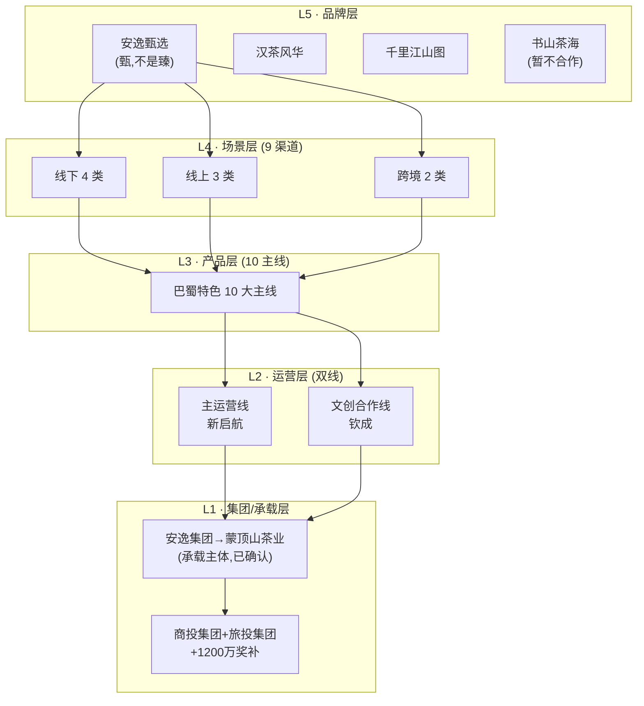

# 安逸臻选二销业务逻辑全景方案 v1.2

> **编制单位**：安逸酒店集团有限责任公司 产业发展部
> **送呈单位**：四川蒙顶山茶业有限公司
> **文档定位**：二销业务逻辑参考方案 v1.2（**聚焦二销本身，去除酒店翻新/品牌运营等非二销内容**）
> **编制日期**：2026 年 10 月 19 日
> **版本**：v1.2（**v1.1 → v1.2：剔除"主题酒店改造 6 点位"+"酒店品牌运营 5 年 5 家"等酒店业务，专注二销业务逻辑**）
> **前版**：v1.1（10-19 上午，已归档）

---

## 一、v1.2 重大变更（相对 v1.1）

| 维度 | v1.1（含酒店内容）| **v1.2（专注二销）** |
|------|----------------|-----------------|
| 钦成主题酒店改造 6 点位 | L4 场景层独立模块 | **移除**（这是酒店翻新，不是二销）|
| 新启航酒店品牌运营 5 年 5 家 | 协议主线 | **降级为支撑层说明**（不是二销主线）|
| L4 场景层 | 7 个节点（含酒店改造）| **精简至 4+3+2=9 个二销渠道节点** |
| 整体聚焦 | 二销+酒店改造混合 | **100% 聚焦二销业务** |

---

## 二、文件信息

| 项目 | 内容 |
|------|------|
| 文件名 | 安逸臻选二销业务逻辑全景方案 v1.2 |
| 主送 | 四川蒙顶山茶业有限公司（培育主体/对外合作承载方）|
| 主送负责人 | 茶业公司领导 |
| 抄送 | 集团领导层、集团本部部门、饭店管理公司 |
| 主撰 | 产业发展部（张实、蒋抒伶）|
| 密级 | 内部 |
| 关键概念 | **本方案仅讨论"二销业务"逻辑，不涉及酒店翻新工程、酒店品牌运营等** |

---

## 三、执行摘要（TL;DR）

**核心逻辑（5 层闭环）**：

```
L5 品牌：安逸甄选（甄！）+ 汉茶风华 + 千里江山图 + 书山茶海（暂不）
   ↓
L4 场景（渠道）：线下 4 类 + 线上 3 类 + 跨境 2 类
   ↓
L3 产品：巴蜀特色 10 大主线
   ↓
L2 运营（双线）：主运营线=新启航 + 文创合作线=钦成
   ↓
L1 集团/承载：安逸集团→蒙顶山茶业（承载主体）+ 商投+旅投
```

**三句话讲清**：
1. **谁来承载**：蒙顶山茶业作为二销业务承载主体（集团商标全部授权至茶业）
2. **谁来操盘**：新启航作为**全权操盘方**，独立打造"安逸甄选"品牌+电商+新媒体平台
3. **业务边界**：本方案只讨论**二销业务**——选品、渠道、销售、运营；**不涉及酒店翻新/品牌运营/餐饮供应链等**（这些由其他专项方案覆盖）

---

## 四、5 层业务逻辑图（v1.2 简化版）



**配套业务逻辑图**：见同目录 `业务拓扑图_v1.2.html` 和 `.png`。

---

## 五、L5 品牌层（二销品牌矩阵）

| 品牌 | 性质 | 状态 | 二销业务角色 |
|------|------|------|------------|
| **安逸甄选**（甄！）| 二销核心品牌 | ✅ 主推 | 酒旅新零售品牌，所有二销商品的统一品牌 |
| **汉茶风华** | 文化母体 | ✅ 主推 | 二销茶品的文化 IP（蒙顶山+西汉吴理真）|
| **千里江山图** | 流量 IP | ✅ 主推 | 二销商品包装、伴手礼、跨境文化叙事 |
| **书山茶海** | 文化活动 IP | ⚪ 暂不合作 | 文化资产保留（未来可重启）|

**品牌用字统一**：本方案及所有后续合同、品牌注册一律使用"**安逸甄选**"（**甄**，不是"臻"）——按 8.31 党委会议案和 9.16 协议统一。

---

## 六、L4 场景层（二销渠道 9 类）

### 6.1 线下 4 类（二销在线下渠道的呈现）

| 渠道 | 形态 | 主运营方 | 备注 |
|------|------|---------|------|
| **① 酒店点位** | 大堂/前台/电梯口货架 | 新启航 | 复用酒店空间做二销陈列 |
| **② 客房入货** | mini-bar + 伴手礼（welcome gift）| 新启航 | 单房溢价高，30%+ 毛利 |
| **③ 主题房** | 汉茶风华 3 档（入门/进阶/旗舰）| 茶业+新启航联合 | **作为二销体验载体**（不是酒店翻新）|
| **④ 自动售货机** | 大堂 24h 无人零售 | 新启航 | 自营模式，1.5-3 万/台 |

**关键说明**：
- 这些是**二销商品的销售场景**，不是酒店翻新工程
- 主题房是**二销商品的体验式销售场景**（买茶礼送汉式点茶体验）
- 不涉及钦成文旅（钦成做的是**主题酒店翻新**，不在本方案范围）

### 6.2 线上 3 类（二销在线上渠道的呈现）

| 渠道 | 平台 | 主运营方 | 备注 |
|------|------|---------|------|
| **① 自建电商平台** | 有赞/微盟（首选有赞）| 新启航 | **新启航自建**，集团授权"安逸甄选"品牌 |
| **② 代运营 + 新媒体矩阵** | 抖音/小红书/视频号/B 站 | 新启航 | 云孚里（抖音）/ 自在云（小红书）|
| **③ 商投私域桥接** | 曙光汇 700 万会员 | 商投 | 后期桥接，业务不合并 |

**新启航独立平台（场景 ①）关键设计**：
- 平台是**新启航的资产**，不是安逸集团的
- 但品牌"安逸甄选"是**集团→茶业→新启航二级授权**
- 新启航独立运营、自担风险、自负盈亏
- 与安逸会员数据**未来桥接**，当下不合并

### 6.3 跨境 2 类（二销在跨境渠道的呈现）

| 渠道 | 平台 | 选品 | 主运营方 |
|------|------|------|---------|
| **① 亚马逊 US/JP + TikTok Shop** | 跨境 B2C | 蒙山五峰/吴理真茶/茶器 | **新启航** |
| **② Etsy 电子文创** | 跨境手工艺 | 东方文化 IP 衍生（40 元→50 美金）| **钦成文旅** |

**跨境合规要点**：
- 茶/食品出口：商投旗下丝路易购（省港投旗下·有现成合规体系）
- 电子文创出海：钦成主导 Etsy 渠道（手工艺品类优势）
- 跨境支付：PingPong / 万里汇（持牌机构）

---

## 七、L3 产品层（巴蜀特色 10 大主线）

| # | 品类 | 巴蜀文化锚 | 二销定位 | 推荐 SKU | 渠道适配 |
|---|------|------------|---------|---------|---------|
| 1 | 蒙顶甘露 | 世界茶文化发源地 | 中高端茶礼 | 蒙山五峰/甘露元年 | 全渠道 |
| 2 | 蒙顶黄芽 | 三黄特色 | 高端茶礼 | 黄芽系列 | 高端渠道 |
| 3 | 雅红工夫 | 蜀地红茶 | 中端茶礼 | 雅红系列 | 中端渠道 |
| 4 | 古蜀藏茶 | 黑茶鼻祖/茶马古道 | 特色茶礼 | 藏茶系列 | 特色渠道 |
| 5 | 茶器 | 竹编/蜀锦非遗 | 主题房/伴手礼 | 雅安竹编茶器+蜀锦茶席 | 主题房+伴手礼 |
| 6 | 茶食 | 川菜大师+茶 | mini-bar/茶点 | 茶味冰粉/茶味花椒糖/麻酱茶酥 | mini-bar+主题房 |
| 7 | 茶宠 | 熊猫/三星堆国宝 IP | 伴手礼 | 熊猫茶宠/三星堆青铜茶宠 | 主题房+伴手礼 |
| 8 | 非遗联名 | 川剧/变脸 | 伴手礼 | 川剧变脸茶礼盒 | 伴手礼+跨境 |
| 9 | ~~书山茶海文创~~ | ~~帆书联运~~ | ~~暂停~~ | ~~联名茶礼~~ | **暂不合作**（资产保留）|
| 10 | 千里江山图衍生 | 央视 IP | 全渠道 | 主题茶礼 | 全渠道（含跨境）|

**SKU 数量策略**：
- 试点期 30-50 个 SKU
- 复制期扩展至 80-120 个
- 跨境 5-8 个高客单 SKU 起步

---

## 八、L2 运营层（双线合作·只做二销业务）

### 8.1 主运营线：新启航（**全权操盘方**）⭐

**角色定位**（基于 9.16 协议 3.2.2）：
> "甲方可授权乙方**全权操盘**'安逸甄选'品牌运营，乙方负责品牌全链条工作"

**在二销业务中的责任**：
- 电商平台搭建与运营（自建平台）
- 新媒体矩阵运营（抖音/小红书/视频号）
- 商品选品与供应链搭建
- 线下门店/酒店点位/客房/自动售货机运营
- 跨境 B2C（亚马逊/TikTok）
- 品牌推广与市场拓展

**新启航的核心能力**（基于 8.31 协议 1.2）：
- 四川省内已成功运营多家酒店
- 完整的 SOP 作业体系
- 酒旅新零售实操能力
- 可独立完成项目落地、市场拓展、战略投资人引进

**新启航不在二销业务中的责任**（明确边界）：
- ❌ 主题酒店改造工程（属酒店翻新，由钦成负责）
- ❌ 酒店品牌运营（5 年 5 家挂牌，属酒店业务，非二销）
- ❌ 餐饮供应链（属商投角色 2）

### 8.2 文创合作线：钦成文旅（**独立合作线**）

**在二销业务中的责任**（只做文创相关）：
- 文创二销产品研发（非遗+电子文创+特色农产品）
- **跨境电子文创**（Etsy 渠道·40 元国内 → 50 美金海外）

**钦成不在二销业务中的责任**（明确边界）：
- ❌ 主题酒店改造工程（属酒店翻新，**本方案不讨论**）
- ❌ 城市更新/非遗主题公园/兴隆湖片区（属城市规划，**本方案不讨论**）

**双线差异化分工**：
| 维度 | 新启航 | 钦成文旅 |
|------|--------|---------|
| 二销品类 | 茶+茶器+茶点+非遗联名 | 文创+电子文创 |
| 渠道 | 酒店点位+电商+新媒体+亚马逊/TikTok | Etsy（跨境手工艺）|
| 角色 | 主运营方（全权操盘）| 文创合作方（独立线）|
| 不做 | 酒店翻新 | 酒店翻新/城市规划 |

---

## 九、L1 集团/承载层

| 主体 | 角色 | 在二销中的责任 |
|------|------|----------------|
| **安逸集团** | 品牌+战略 | 商标注册·品牌战略·战略审批·合规审计 |
| **蒙顶山茶业** ⭐ | **承载主体**（已确认）| 商标被授权·品牌二次授权·质量监督·巴蜀特色 10 主线选品·牛碾坪资源 |
| **商投集团** | 供应链+渠道 | 角色 1 点位互换·角色 2 餐饮供应·角色 3 二销独立供应·角色 4 流量互嵌（曙光汇 700 万）|
| **旅投集团** | 战略背书 | 集团品牌背书·省国资委协调·政策资源 |
| **1200 万省级奖补** | 资金支持 | 文旅融合新场景·已获批·事中激励 |
| **浙川协作机制** | 政策支持 | 千万工程样板 |
| **陈宗懋院士工作站** | 茶科技背书 | 茶科技研发·科研合作 |

**商标授权链**（合规通道）：
```
安逸集团 → 蒙顶山茶业（全部商标） → 新启航/钦成（二次授权）
```

这是 0821 钦成会议明确的"二次授权模式"——既符合国资委审计，又给运营方独立空间。

---

## 十、9 类二销渠道 × 10 大产品的销售矩阵

| 渠道 \ 产品 | 蒙顶甘露 | 黄芽 | 雅红 | 藏茶 | 茶器 | 茶食 | 茶宠 | 非遗联名 | 千里江山图 |
|------------|---------|------|------|------|------|------|------|---------|-----------|
| ① 酒店点位 | ✅ | ⭐ | ✅ | ✅ | ✅ | ✅ | ✅ | ✅ | ✅ |
| ② 客房入货 | ✅ | —— | ✅ | ✅ | —— | ✅ | —— | —— | ✅ |
| ③ 主题房 | ⭐ | ✅ | ✅ | —— | ⭐ | ✅ | ✅ | ✅ | ⭐ |
| ④ 自动售货机 | ✅ | —— | —— | —— | —— | ✅ | —— | —— | —— |
| ⑤ 自建电商 | ⭐ | ✅ | ✅ | ✅ | ✅ | ✅ | ✅ | ✅ | ✅ |
| ⑥ 新媒体 | ⭐ | ✅ | ✅ | ✅ | ✅ | ✅ | ✅ | ✅ | ⭐ |
| ⑦ 商投私域 | ✅ | ⭐ | ✅ | ✅ | —— | ✅ | —— | —— | —— |
| ⑧ 亚马逊/TikTok | ⭐ | ✅ | —— | —— | ✅ | —— | ✅ | ✅ | ⭐ |
| ⑨ Etsy 电子文创 | —— | —— | —— | —— | —— | —— | —— | ⭐ | —— |

**矩阵解读**：
- 蒙顶甘露 + 汉茶风华 是**全渠道主推**（✅ 9 个渠道）
- 千里江山图衍生品 是**跨境主推**（含 Etsy/亚马逊）
- 非遗联名 是**钦成专长**（Etsy 跨境）
- 茶器/茶食 偏**主题房+伴手礼**场景

---

## 十一、全网酒店分润基准（二销相关）

| 模式 | 全网案例 | 茶业/IP 方 | 酒店/点位 | 备注 |
|------|---------|----------|----------|------|
| mini-bar 茶饮 | 亚朵 | 50-70% 毛利 | 30% 分润 | 高溢价 |
| mini-bar 茶饮 | 全季 | 50-65% 毛利 | 25% 分润 | 标准化 |
| IP 联名主题房 | Hello Kitty×锦江 | 10-15% | 85-90% | IP 授权 |
| 品牌联名主题房 | 亚朵×八马茶业 | 25-30% | 70-80% | 联营 |
| **产地体验主题房** | **木莲庄/松赞** | **25-35%（推荐）** | **65-75%** | **溢价高** |
| 酒店自动售货机 | 友宝/魔购 | 65-75%（自营）| 25-30% | 24h |
| 酒店伴手礼 | 行业基准 | 60-75% | 25-40% | 高毛利 |

**关键判断**（Eric 10-18 明确）：
- 酒店分成**只涉及在酒店展销的线下部分**（茶业 ↔ 酒店/景区）
- **商投集团点位互换不涉及利润分成**（是资源互换行为）
- **真正需要分配的是线上部分**（自建平台 GMV 分账）
- 集团**试点期免品牌授权费**（培育期），复制期按 GMV 5-8% 抽成

---

## 十二、商投 4 角色（只列二销相关）

| 角色 | 性质 | 二销相关责任 |
|------|------|------------|
| 角色 1：线下点位互换方 | 资源互换 | 安逸酒店 ↔ 红旗连锁/曙光汇（**不分钱**）|
| 角色 2：安逸酒店供应商 | 集团采购 | 餐饮供应链（**不属二销，仅支撑酒店**）|
| 角色 3：茶业/新启航独立供应商 ⭐ | 独立采购 | 二销商品+跨境选品（**直接服务新启航平台**）|
| 角色 4：流量互嵌方 | 渠道关系 | 曙光汇 700 万→安逸 160 万（后期桥接）|

---

## 十三、跨境二销业务（已落地需求）

### 13.1 双线分工

| 渠道 | 选品 | 客单价 | 巴蜀特色化 | 主运营 |
|------|------|--------|----------|-------|
| 亚马逊 US | 蒙山五峰/吴理真茶 | ¥2980-5000 | "中国茶圣·吴理真"故事 | 新启航 |
| 亚马逊 JP | 蒙山五峰甘露特级 | ¥2980-5000 | 日本茶文化基因相近 | 新启航 |
| TikTok Shop | 联名款（暂缓）| ¥500-1500 | 千里江山图视觉+汉式点茶视频 | 新启航 |
| **Etsy** | **东方文化电子文创** | **$50（≈¥360）** | **非遗+国宝 IP** | **钦成文旅** |
| 阿里国际站 | 三文鱼/菜油（商投供货 B2B）| 议价 | 国资委背书 | 新启航 |
| 丝路易购 | "安逸甄选"品牌出海 | 议价 | 川茶文化输出 | 新启航 |

### 13.2 跨境选品逻辑

**核心原则**（Eric 偏好）：**高客单非标**——避开 TEMU/SHEIN 等价格战红海

| 品类 | 客单价定位 | 理由 |
|------|----------|------|
| 蒙山五峰（顶奢茶）| ¥2980+ | 川茶国际锚点，6 倍毛利率 |
| 蜀锦非遗联名茶礼 | ¥800-1500 | 非遗+独家+情绪价值 |
| 东方文化电子文创 | ¥360（$50）| 钦成主导，国内 40 元→海外 50 美金 |
| 吴理真茶（创始 IP）| 议价 | 华人圈文化 IP（B2B）|

### 13.3 跨境合规要点

- **茶/食品出口**：商投旗下**丝路易购**（省港投旗下，已运营 800+ 川企，10 亿+ 出口）
- **电子文创出海**：钦成主导 Etsy（手工艺品类合规友好）
- **跨境支付**：PingPong / 万里汇（持牌机构）
- **汇率风险**：锁汇产品

---

## 十四、90 天路线图（v1.2 精简·只二销）

| 阶段 | 时间 | 关键动作 | 输出 | 主导方 |
|------|------|---------|------|--------|
| **T+0~15** | 10-19 ~ 11-02 | 商标核查+品牌名统一+新启航协议细化+钦成协议启动 | 安逸甄选品牌统一+主协议 v3.0 | 产业部+茶业+新启航+钦成 |
| **T+15~30** | 11-03 ~ 11-17 | 茶业与新启航签《安逸甄选新零售合作专项协议》+钦成签《文创二销合作协议》+主题房样板选址 | 2 份专项合同+1 家旗舰酒店主题房 | 产业部+茶业+新启航+钦成 |
| **T+30~60** | 11-18 ~ 12-17 | 新启航自建平台 MVP 上线+钦成文创产品启动+自动售货机首批 | 新启航平台 MVP+30 家酒店自动售货机+文创选品 20 个 | 新启航+钦成+茶业 |
| **T+60~90** | 12-18 ~ 01-16 | 跨境首单（亚马逊+Etsy）+主题房复制+品牌发布会 | 跨境首单+5-10 家酒店主题房+1 场品牌发布会 | 新启航+钦成+茶业+集团 |
| **T+90 后** | 01-17 ~ | 复制期 | 30+ 酒店+10+ 主题房+跨境常态化 | 全面 |

---

## 十五、风险与护栏（v1.2 二销聚焦）

| 风险 | 触发条件 | 护栏 |
|------|---------|------|
| **新启航全权操盘失控** | 乙方独立运营，品牌方监督缺位 | 协议 3.2.2 留"重大事项须事先取得甲方书面同意" |
| **品牌名"甄选/臻选"不一致** | 党委会议案/协议/蒋方文档用字不同 | **v1.2 统一为"安逸甄选"**（甄）|
| **新启航数据归属** | 乙方独立运营产生数据 | 协议 4.1/4.2：会员数据归甲方；经营数据需对接甲方系统 |
| **新启航退出** | 协议解除/到期 | 协议 7.5：乙方已签项目通过三方协议转让给甲方/锦江饭店管理公司 |
| **品牌履约保证金** | 乙方连续 3 次被书面整改 | 协议 3.1.9：单个项目 5 万元扣保证金 |
| **跨境合规** | 茶/食品/电子文创出口 | 钦成：电子文创走 Etsy 渠道；新启航：丝路易购合作 |
| **国资委审计** | 资源互换≠采购 | 新启航走"品牌二次授权"模式（合规通道）|
| **钦成/新启航业务冲突** | 两条独立线可能重叠 | 钦成=文创+Etsy；新启航=品牌+电商+主运营——差异化分工 |
| **业务边界外溢** | 二销方案混入酒店翻新内容 | **v1.2 已剔除**——所有酒店翻新/品牌运营内容移出 |

---

## 十六、立即可执行清单（v1.2）

### 今天（10-19）

- [ ] **品牌名统一**：行文/合同/品牌注册一律用"**安逸甄选**"（甄）
- [ ] **新启航协议细化**：茶业与新启航对齐《安逸甄选新零售合作专项协议》关键条款
- [ ] **钦成协议启动**：茶业与钦成对齐《文创二销合作协议》——**只谈文创，不谈酒店改造**
- [ ] **业务边界明确**：与茶业、集团明确"本方案只讨论二销业务，不讨论酒店翻新"

### 本周（10-19 ~ 10-25）

- [ ] 茶业出《与新启航合作专项协议》初稿
- [ ] 茶业出《与钦成文创二销合作协议》初稿
- [ ] 集团办公会汇报《二销业务方案 v1.2》（精简版）
- [ ] 启动新启航自建电商平台技术选型
- [ ] 启动钦成文创产品选品

### 30 天（10-19 ~ 11-18）

- [ ] 新启航自建平台 MVP 上线
- [ ] 钦成文创选品 20 个 SKU
- [ ] 完成 30 家酒店 mini-bar 升级（商投天府优选）
- [ ] 完成 10 家酒店自动售货机部署
- [ ] 跨境 SKU 5-8 个上架

### 90 天（10-19 ~ 2027-01-17）

- [ ] 完成 1 原型店 + 3 酒店 + 30 SKU 试点
- [ ] 完成跨境首单（亚马逊+Etsy 各 1 单）
- [ ] 完成 1 场品牌发布会
- [ ] 集团办公会通过《分配机制正式文件》

---

## 十七、v1.0 / v1.1 → v1.2 业务范围对照表

| 业务模块 | v1.0 | v1.1 | **v1.2（当前）** | 备注 |
|---------|------|------|----------------|------|
| 二销品牌打造 | ✅ | ✅ | ✅ | 核心 |
| 巴蜀特色 10 主线 | ✅ | ✅ | ✅ | 核心 |
| 5 层业务架构 | ✅ | ✅ | ✅ | 核心 |
| 商投 4 角色 | ✅ | ✅ | ✅ | 二销相关 |
| 新启航（主运营线）| ❌ | ✅ | ✅ | 核心 |
| 钦成文旅（文创线）| ❌ | ✅ | ✅ | 二销相关 |
| 跨境业务 | ❌ | ✅ | ✅ | 二销相关 |
| **主题酒店改造 6 点位** | ❌ | ✅ | **❌ 剔除** | **属酒店翻新，非二销** |
| **酒店品牌运营 5 年 5 家** | ❌ | ✅ | **❌ 剔除** | **属酒店业务，非二销** |
| **6 大改造点位投资测算** | ❌ | ✅ | **❌ 剔除** | **属酒店投资** |
| **酒店餐饮供应链** | ✅ | ✅ | **⚪ 弱化** | **不属二销主线** |
| 酒店存量物业盘活 | ✅ | ✅ | **⚪ 弱化** | 不属二销 |
| 锦江饭店管理公司角色 | ✅ | ✅ | **⚪ 弱化** | 二销中仅支撑 |

**核心原则**：本方案**只讨论二销业务**——商品/品牌/渠道/运营/跨境。其他业务（酒店翻新/品牌运营/餐饮/存量盘活）由其他专项方案覆盖。

---

## 十八、附件清单（v1.2 精简·只列二销相关）

| 附件 | 文件 | 用途 |
|------|------|------|
| 附件 1 | 业务拓扑图（HTML v1.2）| 交互式查看 |
| 附件 2 | 业务拓扑图（PNG v1.2）| 印刷/邮件 |
| 附件 3 | 新启航框架协议 v2.0_再框架版（9 月版）| 主运营方基础 |
| 附件 4 | 新启航框架协议 9.16 原版 | 8.31 议案配套 |
| 附件 5 | 新启航框架协议 8.31 议案版 | 党委会审议稿 |
| 附件 6 | 新启航框架协议 9.10 律师审核稿 | 律师审核参考 |
| 附件 7 | 关于召开安逸酒店集团与四川新启航酒旅合作框架协议研讨会的通知 | 程序性文件 |
| 附件 8 | 安逸-商投合作框架协议 v1.3 | 商投合作 |
| 附件 9 | 安逸甄选新零售业态培育工作专班方案（修订版）| 治理结构 |
| 附件 10 | 安逸甄选（拟）双集团合作框架要点（讨论稿）| 9 项待确认 |
| 附件 11 | 安逸甄选外部合作运营商全景报告 v3.0 全国版 | 70+ 候选方 |
| 附件 12 | 蒙顶山茶业 2025 企业介绍 | 茶业公司基本面 |
| 附件 13 | 蒙顶山茶业产品报价表（20260828）| SKU 报价 |
| 附件 14 | 安逸茶山&安逸美舍产品列表（2026.8.26）| 现有产品 |
| 附件 15 | 安逸美舍·蒙顶山茶旅融合项目合作推介 | 美舍资源（仅作二销参考）|
| 附件 16 | 250306 安逸茶山康养休生谷项目汇报 PPT | 康养配套（仅作二销参考）|
| 附件 17 | 安逸茶山文旅融合新场景项目推进会纪要（10-08）| 1200 万奖补 |
| 附件 18 | 四川省旅投与商投集团业务合作对接会（9-18）| 双集团合作起源 |
| 附件 19 | 安逸集团二销业务体系搭建方案探讨（10-18）| Eric 思路原始记录 |

> **本方案不包含的附件**（其他业务由其他方案覆盖）：
> - 主题酒店改造相关文件（钦成文旅会议纪要仅作二销参考）
> - 酒店品牌运营相关文件（新启航协议 6 月内 5 家内容）
> - 酒店餐饮供应链相关文件
> - 酒店存量物业盘活相关文件

---

> **编制说明**：
> 1. 本方案为产业发展部给茶业公司的**二销业务逻辑参考方案 v1.2**，非终稿
> 2. v1.2 **剔除所有非二销业务内容**（酒店翻新/品牌运营等），专注二销本身
> 3. 茶业公司收到后请组织专题讨论
> 4. 修订后由产业发展部统一报集团办公会审批
> 5. 最终方案以集团文件下发为准
>
> **联系窗口**：产业发展部（张实、蒋抒伶）

— 安逸酒店集团有限责任公司 产业发展部
— 2026 年 10 月 19 日
