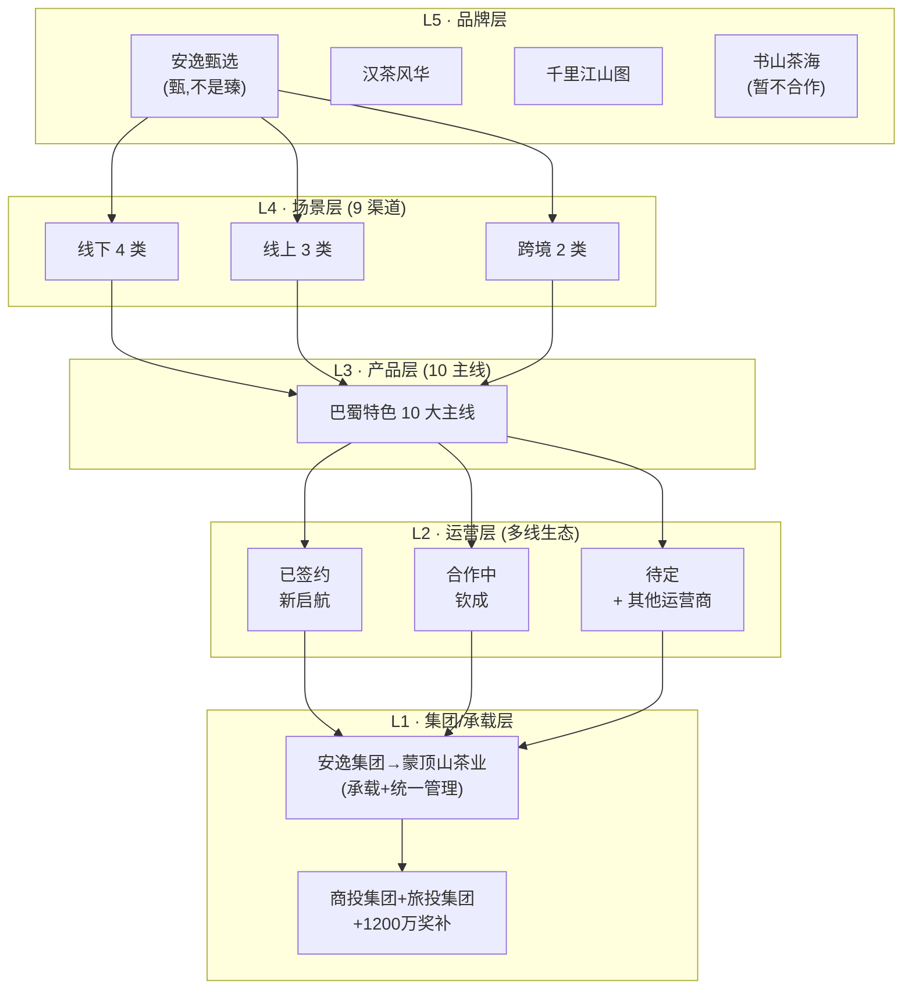

# 安逸甄选二销业务逻辑全景方案 v1.3

> **编制单位**：安逸酒店集团有限责任公司 产业发展部
> **送呈单位**：四川蒙顶山茶业有限公司
> **文档定位**：二销业务逻辑参考方案 v1.3（**修正新启航定位：从"全权操盘方"降级为"已签约外部运营商之一"**）
> **编制日期**：2026 年 10 月 20 日
> **版本**：v1.3（**修正新启航定位 / 强化蒙顶山茶业"多运营商统一管理"角色 / 为其他运营商预留接口**）
> **前版**：v1.2（10-19，已归档）

---

## 一、v1.3 重大修正（相对 v1.2）

| 维度 | v1.2（已修正）| **v1.3（当前）** |
|------|------------|----------------|
| 新启航定位 | **全权操盘方**（独家）| **已签约的外部运营商之一**（非独家）|
| 蒙顶山茶业角色 | 承载主体 | **承载主体 + 多运营商统一管理方**（角色升级）|
| 外部运营商生态 | 单线（新启航）| **多线（新启航+钦成+待定）** |
| 协议 3.2.2 解读 | "全权独家" | **"全产业链操盘但非独家"** |

**核心修正**：协议 3.2.2 的"全权操盘"是修饰操盘范围（产业链全覆盖），不是修饰独家性。新启航是众多外部运营商之一，蒙顶山茶业负责统一管理。

---

## 二、文件信息

| 项目 | 内容 |
|------|------|
| 文件名 | 安逸臻选二销业务逻辑全景方案 v1.3 |
| 主送 | 四川蒙顶山茶业有限公司（承载主体+多运营商统一管理）|
| 主送负责人 | 茶业公司领导 |
| 抄送 | 集团领导层、集团本部部门、饭店管理公司、新启航（已签约方）、钦成文旅（合作中）|
| 主撰 | 产业发展部（张实、蒋抒伶）|
| 密级 | 内部 |
| 关键概念 | **本方案只讨论二销业务，不涉及酒店翻新/品牌运营/餐饮供应链等** |

---

## 三、执行摘要（TL;DR）

**核心逻辑（5 层闭环）**：

```
L5 品牌：安逸甄选（甄！）+ 汉茶风华 + 千里江山图 + 书山茶海（暂不）
   ↓
L4 场景（渠道）：线下 4 类 + 线上 3 类 + 跨境 2 类
   ↓
L3 产品：巴蜀特色 10 大主线
   ↓
L2 运营（多线生态）：已签约=新启航 + 合作中=钦成 + 待定=？
   ↓
L1 集团/承载：安逸集团→蒙顶山茶业（承载+统一管理）+ 商投+旅投
```

**三句话讲清**：
1. **谁来承载**：蒙顶山茶业（已确认）——集团商标全部授权至茶业，由茶业**统一管理多家外部运营商**
2. **谁来操盘**：**多运营商生态**——新启航是**已签约的外部运营商之一**（负责酒店+新零售全产业链），钦成文旅合作中（文创+Etsy），其他运营商待定
3. **业务边界**：本方案只讨论**二销业务**——选品、渠道、销售、运营、跨境；不涉及酒店翻新/品牌运营/餐饮供应链等

---

## 四、5 层业务逻辑图（v1.3 多运营商版）



**配套业务逻辑图**：见同目录 `业务拓扑图_v1.3.html` 和 `.png`。

---

## 五、L2 运营层（v1.3 关键修正·多运营商生态）

### 5.1 蒙顶山茶业（**承载主体+统一管理方**）⭐ 升级角色

**v1.3 新定位**：
- 不仅承载二销业务，还**统一管理多家外部运营商**
- 集团商标持有人（被授权方）
- 品牌二次授权方（向多家运营商授权）
- 运营商之间的**协调方+质量监督方**

**统一管理责任**：
- 制定运营商准入标准
- 监督运营商服务质量（质检体系）
- 协调运营商之间的业务边界（如：新启航做茶，钦成做文创，避免重叠）
- 数据归集（所有运营商数据归茶业统一汇总）
- 利益分配协调（多运营商之间的协同分润）

### 5.2 已签约运营商：新启航（**之一**·非独家）

**v1.3 重新定位**：
> 新启航 = 已签约的外部运营商之一（不是"全权独家操盘方"）

**协议依据**（9.16 协议 3.2.2）：
> "甲方可授权乙方全权操盘'安逸甄选'品牌运营，乙方负责品牌全链条工作"
- ✅ 全权操盘 = 全产业链操盘能力
- ❌ 不是全独家——蒙顶山茶业可签其他运营商

**新启航的责任范围**：
- 酒店品牌运营（5 年内 5 家挂牌——属酒店业务，非二销）
- 酒旅新零售业务（"安逸甄选"全产业链——属二销）
- 电商平台搭建与运营（自建）
- 新媒体矩阵运营（抖音/小红书/视频号）
- 线下酒店点位/客房/自动售货机运营
- 跨境 B2C（亚马逊/TikTok，茶+茶器）

**新启航的边界**：
- ❌ 不是唯一运营商——蒙顶山茶业可签其他
- ❌ 不做主题酒店改造工程（属酒店翻新）
- ❌ 不做文创（钦成的领域）

### 5.3 合作中运营商：钦成文旅（**独立合作线**）

**v1.3 定位**：
- 独立合作线，**与新启航互补不冲突**
- 二销业务中只做文创相关

**钦成在二销中的责任**：
- 文创二销产品研发（非遗+电子文创+特色农产品）
- **跨境电子文创**（Etsy 渠道·40 元国内→50 美金海外）

**钦成边界**：
- ❌ 不做主题酒店改造（属酒店翻新）
- ❌ 不做茶/茶器/茶食（新启航的领域）

### 5.4 待定运营商：+ 其他（**预留接口**）

**v1.3 预留的逻辑**：
- 蒙顶山茶业作为统一管理方，可根据业务需要签更多运营商
- 可能的潜在运营商类型：
  - 茶供应链专门方（与商投对接）
  - 新媒体专门方（与新启航互补）
  - 主题房 IP 授权方（茶业直接管理）
  - 数据/会员体系服务商
- **具体名单待 Eric 后续指定**

---

## 六、L1 集团/承载层（v1.3 加强蒙顶山茶业）

| 主体 | 角色 | 在二销中的责任 |
|------|------|----------------|
| **安逸集团** | 品牌+战略 | 商标注册·品牌战略·战略审批·合规审计 |
| **蒙顶山茶业** ⭐ | **承载主体 + 多运营商统一管理**（角色升级）| 商标被授权·品牌二次授权·质量监督·运营商管理·巴蜀特色 10 主线选品·牛碾坪资源 |
| **商投集团** | 供应链+渠道 | 角色 1 点位互换·角色 2 餐饮供应·角色 3 二销独立供应·角色 4 流量互嵌（曙光汇 700 万）|
| **旅投集团** | 战略背书 | 集团品牌背书·省国资委协调·政策资源 |
| **1200 万省级奖补** | 资金支持 | 文旅融合新场景·已获批·事中激励 |
| **浙川协作机制** | 政策支持 | 千万工程样板 |
| **陈宗懋院士工作站** | 茶科技背书 | 茶科技研发·科研合作 |

**商标授权链**（v1.3 多运营商版）：
```
安逸集团 → 蒙顶山茶业（全部商标）
                ↓ 二次授权（统一管理）
                ├─→ 新启航（已签约·酒店+新零售）
                ├─→ 钦成文旅（合作中·文创+Etsy）
                └─→ 其他运营商（待定）
```

---

## 七、L5 品牌层（保持不变）

| 品牌 | 性质 | 状态 | 二销业务角色 |
|------|------|------|------------|
| **安逸甄选**（甄！）| 二销核心品牌 | ✅ 主推 | 酒旅新零售品牌，所有二销商品的统一品牌 |
| **汉茶风华** | 文化母体 | ✅ 主推 | 二销茶品的文化 IP（蒙顶山+西汉吴理真）|
| **千里江山图** | 流量 IP | ✅ 主推 | 二销商品包装、伴手礼、跨境文化叙事 |
| **书山茶海** | 文化活动 IP | ⚪ 暂不合作 | 文化资产保留（未来可重启）|

**品牌用字统一**：本方案及所有后续合同、品牌注册一律使用"**安逸甄选**"（**甄**，不是"臻"）。

---

## 八、L4 场景层（保持不变·9 渠道）

### 8.1 线下 4 类

| 渠道 | 形态 | 运营商 |
|------|------|--------|
| **① 酒店点位** | 大堂/前台/电梯口货架 | 新启航 |
| **② 客房入货** | mini-bar + 伴手礼（welcome gift）| 新启航 |
| **③ 主题房** | 汉茶风华 3 档（入门/进阶/旗舰）| 茶业+新启航 |
| **④ 自动售货机** | 大堂 24h 无人零售 | 新启航 |

### 8.2 线上 3 类

| 渠道 | 平台 | 运营商 |
|------|------|--------|
| **⑤ 自建电商平台** | 有赞/微盟（首选有赞）| **新启航** |
| **⑥ 代运营 + 新媒体矩阵** | 抖音/小红书/视频号/B 站 | **新启航** |
| **⑦ 商投私域桥接** | 曙光汇 700 万会员 | 商投 |

### 8.3 跨境 2 类（双运营商分工）

| 渠道 | 平台 | 选品 | 运营商 |
|------|------|------|--------|
| **⑧ 亚马逊 US/JP + TikTok Shop** | 跨境 B2C | 蒙山五峰/吴理真茶/茶器 | **新启航** |
| **⑨ Etsy 电子文创** | 跨境手工艺 | 东方文化 IP 衍生 | **钦成文旅** |

---

## 九、L3 产品层（保持不变·10 主线）

| # | 品类 | 二销定位 | 渠道适配 |
|---|------|---------|---------|
| 1 | 蒙顶甘露 | 中高端茶礼 | 全渠道 |
| 2 | 蒙顶黄芽 | 高端茶礼 | 高端渠道 |
| 3 | 雅红工夫 | 中端茶礼 | 中端渠道 |
| 4 | 古蜀藏茶 | 特色茶礼 | 特色渠道 |
| 5 | 茶器 | 主题房/伴手礼 | 主题房+伴手礼 |
| 6 | 茶食 | mini-bar/茶点 | mini-bar+主题房 |
| 7 | 茶宠 | 伴手礼 | 主题房+伴手礼 |
| 8 | 非遗联名 | 伴手礼 | 伴手礼+跨境（钦成 Etsy）|
| 9 | ~~书山茶海~~ | ~~暂停~~ | **暂不合作** |
| 10 | 千里江山图衍生 | 全渠道 | 全渠道（含跨境）|

---

## 十、9 类二销渠道 × 10 大产品销售矩阵

| 渠道 \ 产品 | 蒙顶甘露 | 黄芽 | 雅红 | 藏茶 | 茶器 | 茶食 | 茶宠 | 非遗联名 | 千里江山图 |
|------------|---------|------|------|------|------|------|------|---------|-----------|
| ① 酒店点位 | ✅ | ⭐ | ✅ | ✅ | ✅ | ✅ | ✅ | ✅ | ✅ |
| ② 客房入货 | ✅ | —— | ✅ | ✅ | —— | ✅ | —— | —— | ✅ |
| ③ 主题房 | ⭐ | ✅ | ✅ | —— | ⭐ | ✅ | ✅ | ✅ | ⭐ |
| ④ 自动售货机 | ✅ | —— | —— | —— | —— | ✅ | —— | —— | —— |
| ⑤ 自建电商 | ⭐ | ✅ | ✅ | ✅ | ✅ | ✅ | ✅ | ✅ | ✅ |
| ⑥ 新媒体 | ⭐ | ✅ | ✅ | ✅ | ✅ | ✅ | ✅ | ✅ | ⭐ |
| ⑦ 商投私域 | ✅ | ⭐ | ✅ | ✅ | —— | ✅ | —— | —— | —— |
| ⑧ 亚马逊/TikTok | ⭐ | ✅ | —— | —— | ✅ | —— | ✅ | ✅ | ⭐ |
| ⑨ Etsy 电子文创 | —— | —— | —— | —— | —— | —— | —— | ⭐ | —— |

**矩阵解读**：
- 蒙顶甘露 = **新启航主推全渠道**
- 非遗联名 = **钦成专长 Etsy 跨境**
- 茶器/茶食 = 主题房+伴手礼场景

---

## 十一、L2 运营层多运营商生态（v1.3 重点）

### 11.1 运营商生态全景

| 运营商 | 状态 | 二销业务范围 | 边界（不做）| 协议基础 |
|--------|------|------------|------------|---------|
| **蒙顶山茶业** | 承载主体 | 统一管理·品牌授权·质量监督 | 不直接运营 | 集团授权 |
| **新启航** | ✅ 已签约 | 酒店+新零售全产业链·电商+新媒体·茶跨境 | 不做文创·不做酒店翻新 | 9.16 框架协议 |
| **钦成文旅** | 🔄 合作中 | 文创产品+Etsy跨境 | 不做茶·不做酒店翻新 | 0821 钦成会议 |
| **其他运营商** | ⚪ 待定 | 待 Eric 后续指定 | —— | —— |

### 11.2 多运营商协同的关键设计

**协同点 1：业务边界清晰**
- 新启航：茶+茶器+茶食+茶宠（实体二销品）
- 钦成：文创+电子文创（非茶品类）
- 待定：可能补足新媒体/供应链/IP/数据等垂直领域

**协同点 2：避免重叠**
- 同一品类不签两家（如：茶只签新启航，文创只签钦成）
- 同一渠道不签两家（如：Etsy 只归钦成，亚马逊只归新启航）

**协同点 3：数据互通**
- 所有运营商的销售数据→蒙顶山茶业汇总
- 会员数据归安逸集团（运营商仅使用权）
- 经营数据需对接蒙顶山茶业系统

**协同点 4：统一品牌**
- 所有运营商统一使用"安逸甄选"品牌
- 蒙顶山茶业做品牌质量监督
- 不同运营商可在品牌下设子系列（如：新启航出品/钦成出品）

### 11.3 多运营商分润机制（v1.3 新增）

**当有多个运营商时，分润逻辑**：

| 主体 | 收入构成 | 占比建议 |
|------|---------|---------|
| **蒙顶山茶业** | 销售毛利+平台运营 | 50-60% |
| **新启航（之一）** | 操盘服务费+GMV 抽成 | 8-12% |
| **钦成（之一）** | 操盘服务费+GMV 抽成 | 8-12%（文创类）|
| **其他运营商（待定）** | 类似 | 8-12% |
| **酒店/景区点位**（线下） | 销售分润 | 15-20% |
| **集团** | 品牌授权费+战略管理费 | 5-8%（试点期免）|
| **平台/工具成本** | 物流/支付/广告 | 8-10% |

**关键设计**：多运营商之间**不是互相分账**——而是各自向蒙顶山茶业结算，避免多头对接。

---

## 十二、商投 4 角色（保持不变）

| 角色 | 性质 | 二销相关责任 |
|------|------|------------|
| 角色 1：线下点位互换方 | 资源互换 | 安逸酒店 ↔ 红旗连锁/曙光汇（**不分钱**）|
| 角色 2：安逸酒店供应商 | 集团采购 | 餐饮供应链（**不属二销**）|
| 角色 3：茶业/新启航独立供应商 ⭐ | 独立采购 | 二销商品+跨境选品 |
| 角色 4：流量互嵌方 | 渠道关系 | 曙光汇 700 万→安逸 160 万（后期桥接）|

---

## 十三、跨境二销业务（双运营商分工·保持不变）

| 渠道 | 选品 | 主运营 |
|------|------|-------|
| 亚马逊 US/JP + TikTok Shop | 茶+茶器 | **新启航** |
| Etsy 电子文创 | 东方文化 IP 衍生（40→50 美金）| **钦成文旅** |
| 阿里国际站 B2B | 三文鱼+菜油（商投供货）| **新启航** |
| 丝路易购 | "安逸甄选"品牌出海 | **新启航** |

---

## 十四、90 天路线图（v1.3·多运营商版）

| 阶段 | 时间 | 关键动作 | 输出 | 主导方 |
|------|------|---------|------|--------|
| **T+0~15** | 10-20 ~ 11-03 | 品牌名统一+新启航协议细化+钦成协议启动+**梳理其他潜在运营商** | 安逸甄选品牌统一+主协议 v3.0+运营商清单 v1.0 | 产业部+茶业 |
| **T+15~30** | 11-04 ~ 11-18 | 茶业与新启航签专项协议+茶业与钦成签专项协议+主题房样板选址 | 2 份专项合同+1 家旗舰酒店主题房 | 茶业+新启航+钦成 |
| **T+30~60** | 11-19 ~ 12-18 | 新启航自建平台 MVP 上线+钦成文创产品启动+自动售货机首批+**新运营商引入（如有）** | 新启航平台 MVP+30 家酒店自动售货机+文创选品 20 个+可能第 3 家运营商 | 新启航+钦成+茶业 |
| **T+60~90** | 12-19 ~ 01-17 | 跨境首单（亚马逊+Etsy）+主题房复制+品牌发布会 | 跨境首单+5-10 家酒店主题房+1 场品牌发布会 | 新启航+钦成+茶业+集团 |
| **T+90 后** | 01-18 ~ | 复制期 | 30+ 酒店+10+ 主题房+跨境常态化 | 全面 |

---

## 十五、风险与护栏（v1.3 增补）

| 风险 | 触发条件 | 护栏 |
|------|---------|------|
| **新启航独占误区** | 之前误读为"全权独家操盘方" | **v1.3 修正：仅为外部运营商之一** |
| **多运营商业务重叠** | 茶+文创边界不清 | 蒙顶山茶业统一管理+品类排他 |
| **运营商之间恶性竞争** | 同一品类签多家 | 同一品类独家原则 |
| **数据归属混乱** | 多家运营商数据分散 | 蒙顶山茶业汇总+对接集团系统 |
| **品牌质量失控** | 多家运营商各自为政 | 蒙顶山茶业质量监督+集团品牌标准 |
| **新启航数据归属** | 乙方独立运营产生数据 | 协议 4.1/4.2：会员数据归甲方；经营数据需对接甲方系统 |
| **新启航退出** | 协议解除/到期 | 协议 7.5：乙方已签项目通过三方协议转让给甲方/锦江饭店管理公司 |
| **品牌履约保证金** | 乙方连续 3 次被书面整改 | 协议 3.1.9：单个项目 5 万元扣保证金 |
| **跨境合规** | 茶/食品/电子文创出口 | 钦成：电子文创走 Etsy 渠道；新启航：丝路易购合作 |
| **国资委审计** | 多家运营商合规 | 蒙顶山茶业统一合规通道（品牌二次授权）|

---

## 十六、立即可执行清单（v1.3）

### 今天（10-20）

- [ ] **新启航定位修正**：v1.2 → v1.3，所有文档统一为"**已签约外部运营商之一**"
- [ ] **蒙顶山茶业角色升级**：从"承载主体"升级为"承载主体+多运营商统一管理方"
- [ ] **业务边界明确**：与新启航/钦成明确"你们是之一，不是独家"
- [ ] **其他运营商梳理**：列出潜在的第 3、第 4 家运营商（茶业+产业部）

### 本周（10-20 ~ 10-26）

- [ ] 茶业出《多运营商管理办法》初稿（准入/退出/数据/分润）
- [ ] 茶业出《与新启航合作专项协议》初稿（v1.3 框架）
- [ ] 茶业出《与钦成文创二销合作协议》初稿
- [ ] 集团办公会汇报《二销业务方案 v1.3》（精简版）
- [ ] 启动新启航自建电商平台技术选型
- [ ] 启动钦成文创产品选品

### 30 天（10-20 ~ 11-18）

- [ ] 新启航自建平台 MVP 上线
- [ ] 钦成文创选品 20 个 SKU
- [ ] 完成 30 家酒店 mini-bar 升级
- [ ] 完成 10 家酒店自动售货机部署
- [ ] 跨境 SKU 5-8 个上架
- [ ] **如有** 第 3 家运营商引入

### 90 天（10-20 ~ 2027-01-17）

- [ ] 完成 1 原型店 + 3 酒店 + 30 SKU 试点
- [ ] 完成跨境首单（亚马逊+Etsy 各 1 单）
- [ ] 完成 1 场品牌发布会
- [ ] 集团办公会通过《分配机制正式文件》（含多运营商）

---

## 十七、v1.0 / v1.1 / v1.2 / v1.3 关键变化追溯

| 版本 | 关键变化 | 新启航定位 | 蒙顶山茶业定位 |
|------|---------|----------|----------------|
| v1.0 | 初版（10-19 上午）| 未明确 | 培育主体 |
| v1.1 | 加入新启航+钦成（10-19 中午）| "运营方之一"（不突出）| 承载主体 |
| v1.2 | 聚焦二销（10-19 下午）| **"全权操盘方"**（**过度解读**）| 承载主体 |
| **v1.3（当前）** | **修正新启航定位+强化茶业统一管理** | **"已签约外部运营商之一"** | **承载主体+多运营商统一管理方** |

**v1.2 → v1.3 唯一重大修正**：新启航定位从"全权操盘方"降级为"已签约外部运营商之一"——蒙顶山茶业从"承载主体"升级为"承载主体+多运营商统一管理方"。

---

## 十八、附件清单（v1.3 保持精简）

| 附件 | 文件 | 用途 |
|------|------|------|
| 附件 1 | 业务拓扑图（HTML v1.3）| 交互式查看 |
| 附件 2 | 业务拓扑图（PNG v1.3）| 印刷/邮件 |
| 附件 3 | 新启航框架协议 v2.0_再框架版 | 主运营方基础 |
| 附件 4 | 新启航框架协议 9.16 原版 | 8.31 议案配套 |
| 附件 5 | 新启航框架协议 8.31 议案版 | 党委会审议稿 |
| 附件 6 | 新启航框架协议 9.10 律师审核稿 | 律师审核参考 |
| 附件 7 | 关于召开安逸酒店集团与四川新启航酒旅合作框架协议研讨会的通知 | 程序性文件 |
| 附件 8 | 安逸-商投合作框架协议 v1.3 | 商投合作 |
| 附件 9 | 安逸甄选新零售业态培育工作专班方案（修订版）| 治理结构 |
| 附件 10 | 安逸甄选（拟）双集团合作框架要点（讨论稿）| 9 项待确认 |
| 附件 11 | 安逸甄选外部合作运营商全景报告 v3.0 全国版 | 70+ 候选方（可补充其他运营商）|
| 附件 12 | 蒙顶山茶业 2025 企业介绍 | 茶业公司基本面 |
| 附件 13 | 蒙顶山茶业产品报价表（20260828）| SKU 报价 |
| 附件 14 | 安逸茶山&安逸美舍产品列表（2026.8.26）| 现有产品 |
| 附件 15 | 安逸美舍·蒙顶山茶旅融合项目合作推介 | 美舍资源（仅作二销参考）|
| 附件 16 | 250306 安逸茶山康养休生谷项目汇报 PPT | 康养配套（仅作二销参考）|
| 附件 17 | 安逸茶山文旅融合新场景项目推进会纪要（10-08）| 1200 万奖补 |
| 附件 18 | 四川省旅投与商投集团业务合作对接会（9-18）| 双集团合作起源 |
| 附件 19 | 安逸集团二销业务体系搭建方案探讨（10-18）| Eric 思路原始记录 |

---

> **编制说明**：
> 1. 本方案为产业发展部给茶业公司的**二销业务逻辑参考方案 v1.3**，非终稿
> 2. v1.3 修正了 v1.2 对协议 3.2.2 的过度解读——新启航是"已签约外部运营商之一"
> 3. 蒙顶山茶业角色升级为"承载主体+多运营商统一管理方"
> 4. 茶业公司收到后请组织专题讨论
> 5. 修订后由产业发展部统一报集团办公会审批
> 6. 最终方案以集团文件下发为准
>
> **联系窗口**：产业发展部（张实、蒋抒伶）

— 安逸酒店集团有限责任公司 产业发展部
— 2026 年 10 月 20 日
